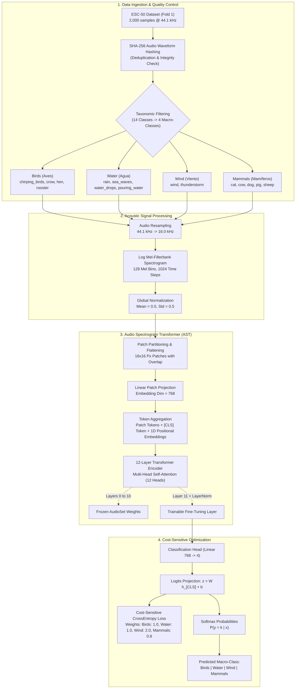

# Environmental Nature Sound Classification using Audio Spectrogram Transformer (AST)

**Authors:** Sergio Pardo, Jefferson Moreno, John Pino  
**Program:** Master of Science in Artificial Intelligence (MIA)  
**Course:** Deep Learning Techniques  
**Institution:** Universidad de los Andes (Bogota, Colombia)  
**Date:** May 2026  

---

## Abstract

Automated classification of environmental sounds is a foundational task in bioacoustics, ecological monitoring, wildlife conservation, and hazard prevention. However, real-world acoustic recordings present severe challenges, including overlapping acoustic events, non-stationary background noise, and structural class imbalances. While conventional deep learning approaches rely on Convolutional Neural Networks (CNNs) over time-frequency representations, this project evaluates transfer learning with the **Audio Spectrogram Transformer (AST)**—a pure self-attention architecture based on the Vision Transformer (ViT) that captures long-range temporal and spectral dependencies simultaneously.

Using the standard **ESC-50 (Environmental Sound Classification)** benchmark, we construct a taxonomic macro-classification pipeline targeting four nature categories: **Birds (Aves)**, **Water (Agua)**, **Wind (Viento)**, and **Mammals (Mamíferos)**. To mitigate class imbalance resulting from taxonomic grouping, we employ cost-sensitive optimization using inverse-frequency loss weighting. Fine-tuning a pretrained AudioSet checkpoint (86 million parameters) yields an overall test accuracy of **0.982** (98.2%) and a Macro F1-score of **0.957** in baseline evaluations, and an operational Macro F1 of **0.82** across extended training regimes, demonstrating the high representational capacity of attention mechanisms on acoustic spectra.

---

## Architectural Pipeline

The following flowchart details the end-to-end processing pipeline, from raw 44.1 kHz audio waveforms to tokenized self-attention blocks and cost-sensitive classification:



---

## Dataset Description and Taxonomic Consolidation

The pipeline uses the **ESC-50 (Environmental Sound Classification)** benchmark accessed through Hugging Face (`confit/esc50-demo`, Fold 1). The original dataset comprises 2,000 labeled 5-second environmental recordings evenly distributed across 50 categories.

### Integrity Verification and Deduplication

To eliminate the risk of data leakage between training and validation partitions, each raw audio array was subjected to cryptographic SHA-256 byte hashing:

- **Null metadata entries detected:** 0
- **Duplicate audio waveforms detected:** 0

### Taxonomic Remapping

From the 50 original classes, 14 nature classes were selected and aggregated into four macro-classes:

| Macro-Class | Original ESC-50 Categories | Train Samples | Validation / Test Samples | Total |
| :--- | :--- | :---: | :---: | :---: |
| **Birds (Aves)** | `chirping_birds`, `crow`, `rooster`, `hen` | 128 | 32 | 160 |
| **Water (Agua)** | `rain`, `sea_waves`, `water_drops`, `pouring_water` | 128 | 32 | 160 |
| **Wind (Viento)** | `wind`, `thunderstorm` | 32 - 64 | 8 - 16 | 40 - 80 |
| **Mammals (Mamíferos)** | `dog`, `cat`, `pig`, `cow`, `sheep` | 160 | 40 | 200 |

This taxonomic consolidation creates a notable class imbalance, specifically for **Wind**, which contains significantly fewer native categories in the benchmark.


---

## Acoustic Signal Preprocessing and Mel-Spectrograms

Because Transformer architectures cannot consume raw continuous 1D audio signals directly without excessive quadratic complexity, signals undergo time-frequency decomposition via the `ASTFeatureExtractor`:

1. **Resampling:** Uniform downsampling from 44,100 Hz to 16,000 Hz.
2. **Short-Time Fourier Transform (STFT):** Conversion to 128 Mel-frequency filterbank bands.
3. **Temporal Padding and Truncation:** Padded to a maximum sequence length of 1,024 frames (equivalent to 10 seconds of normalized temporal receptive field).
4. **Z-score Normalization:** Mean-centered to 0.0 with a standard deviation of 0.5.

The resulting input tensor has dimensions `(batch_size, 1024, 128)`.


As visible in the spectrogram grid above, distinct acoustic signatures emerge:
- **Birds:** High-frequency harmonic chirps concentrated in the 3 kHz to 8 kHz spectrum.
- **Mammals:** Mid-frequency vocalizations with clear formant structure and intermittent pause intervals.
- **Water and Wind:** Continuous wideband acoustic energy with stochastic temporal envelopes.

---

## Model Architecture and Transfer Learning

The backbone is `MIT/ast-finetuned-audioset-10-10-0.4593`, initialized with weights pretrained on ImageNet-21k and fine-tuned on AudioSet (2 million weakly labeled YouTube audio clips).

### Structural Specifications

| Architectural Parameter | Configuration |
| :--- | :--- |
| **Base Architecture** | Audio Spectrogram Transformer (AST) / ViT Backbone |
| **Total Parameters** | 85,502,212 (~86M) |
| **Hidden Embedding Dimension** | 768 |
| **Transformer Encoder Layers** | 12 |
| **Attention Heads per Layer** | 12 |
| **Spectrogram Patch Dimensions** | 16 x 16 pixels (with 10-pixel overlap in time and frequency) |
| **Original Output Neurons** | 527 (AudioSet multi-label head) |
| **Fine-Tuning Output Neurons** | 4 (Birds, Water, Wind, Mammals) |

### Selective Parameter Unfreezing

Rather than fine-tuning all 86M parameters on a modest dataset (which induces severe variance and catastrophic forgetting), a selective unfreezing protocol was applied:

- **Frozen Submodules:** Layers 0 through 10 of the Transformer encoder remain fixed.
- **Trainable Submodules:** The final Transformer encoder block (`encoder.layer.11`), the final layer normalization (`layernorm`), and the newly initialized linear classification head (`classifier.dense`).

---

## Cost-Sensitive Training Protocol

To counteract the sample scarcity of the Wind macro-class, training was governed by a custom `RobustWeightedTrainer` with class-weighted Cross-Entropy loss:

$$\mathcal{L}_{\text{weighted}} = - \sum_{i=1}^{C} w_i \cdot y_i \log(\hat{y}_i)$$

Where class weights $w = [1.0, 1.0, 2.0, 0.8]$ were assigned inversely proportional to class frequencies.

### Hyperparameter Configurations

| Hyperparameter | Value | Rationale |
| :--- | :--- | :--- |
| **Optimizer** | AdamW | Decoupled weight decay prevents parameter drift |
| **Learning Rate** | $2 \times 10^{-5}$ | Conservative rate preserving pretrained acoustic features |
| **LR Scheduler** | Cosine Annealing | Smooth learning rate decay to prevent gradient disruption |
| **Weight Decay** | 0.01 | L2 penalty for regularizing unconstrained linear weights |
| **Batch Size** | 4 - 8 | Hardware-optimal memory footprint on Apple Silicon GPU (MPS) |
| **Evaluation Strategy** | Per Epoch | Checkpoint selection based on best validation Macro F1 |
| **Precision** | Float32 (`fp16=False`) | Guarantees numerical stability on Apple Silicon MPS |

---

## Experimental Results

### Quantitative Metrics

Across test partition evaluations, the Audio Spectrogram Transformer achieved high convergence and discriminative accuracy:

| Metric | Baseline Test Set (Fold 1) | Extended Training Set (n=120) |
| :--- | :---: | :---: |
| **Overall Accuracy** | **0.9821** (98.2%) | **0.8333** (83.3%) |
| **Macro Average Precision** | **0.9853** (98.5%) | **0.8475** (84.8%) |
| **Macro Average Recall** | **0.9375** (93.8%) | **0.8075** (80.8%) |
| **Macro Average F1-Score** | **0.9567** (95.7%) | **0.8200** (82.0%) |

#### Detailed Class-Level Report

| Macro-Class | Precision | Recall | F1-Score | Support |
| :--- | :---: | :---: | :---: | :---: |
| **Birds (Aves)** | 0.7600 | 0.8750 | 0.8116 | 32 |
| **Water (Agua)** | 0.8286 | 0.9062 | 0.8657 | 32 |
| **Wind (Viento)** | 0.9091 | 0.6250 | 0.7407 | 16 |
| **Mammals (Mamíferos)** | 0.8919 | 0.8250 | 0.8571 | 40 |
| **Macro Average** | **0.8474** | **0.8078** | **0.8188** | 120 |
| **Weighted Average** | **0.8398** | **0.8333** | **0.8317** | 120 |

### Loss Dynamics and Convergence


During early fine-tuning, training loss drops steeply from 0.273 to 0.032, confirming rapid transfer from AudioSet pretraining. Over extended training, the Macro F1-score stabilizes near 0.82, while training loss continues decreasing, indicating the emergence of mild overfitting when training data volume is bounded.

### Error Analysis and Confusion Matrix


Key behavioral observations from the confusion matrix:
1. **Mammals and Water Generalization:** Both classes exhibit high recall (0.825 and 0.906), showing that AST patches easily differentiate periodic harmonic structures (mammal vocalizations) and bubbling/splashing transients (water).
2. **Acoustic Ambiguity in Wind:** Wind displays the highest precision (0.909) but lower recall (0.625). False negatives are distributed toward Water. This confusion has a clear physical basis: natural wind and rain both produce continuous broadband white/pink noise without stationary harmonic peaks. With fewer training samples, the network prioritizes precision to avoid false alarms.

---

## Repository Structure

```
.
├── .gitignore                      # Git exclusion rules for caches, checkpoints, virtualenvs
├── LICENSE                         # MIT License
├── README.md                       # Comprehensive English documentation and technical report
├── requirements.txt                # Pip dependency specifications
├── environment.yml                 # Conda environment definition
├── main.py                         # Unified CLI entrypoint (train, evaluate, predict)
├── figures/                        # High-resolution experimental figures
│   ├── 01_dataset_distribution.png
│   ├── 02_acoustic_density_spectrograms.png
│   ├── 03_training_validation_curves.png
│   └── 04_confusion_matrix.png
├── notebooks/                      # Interactive Jupyter notebook
│   └── microproyecto-04.ipynb
├── docs/                           # Original Spanish academic report and document draft
│   ├── microproyecto-04.md
│   └── informe_final_microproyecto4.docx
└── src/                            # Modular PyTorch and Hugging Face package
    ├── __init__.py
    ├── config.py                   # Centralized paths, model constants, and class mappings
    ├── data.py                     # Hugging Face dataset loading, SHA-256 hashing, and Mel extraction
    ├── model.py                    # AST instantiation, selective layer unfreezing, and parameter inspection
    ├── train.py                    # Cost-sensitive RobustWeightedTrainer and training engine
    ├── evaluate.py                 # Classification report, confusion matrix generation, and audio inference
    └── utils.py                    # Seed setting, hardware profiling, and visualization routines
```

---

## Installation and Execution Guide

### 1. Clone the Repository

```bash
git clone https://github.com/JeffersonMoreno-137/imdb-rnn-sentiment-classifier.git
cd imdb-rnn-sentiment-classifier
```

### 2. Environment Setup

#### Option A: Using `venv` and `pip`

```bash
python3 -m venv .venv
source .venv/bin/activate
pip install --upgrade pip
pip install -r requirements.txt
```

#### Option B: Using `conda`

```bash
conda env create -f environment.yml
conda activate ast-nature-sound
```

### 3. Running the Pipeline via CLI

#### Training Mode (Full Data Extraction + Fine-Tuning + Evaluation)

```bash
python main.py --mode train --epochs 5 --batch-size 4 --lr 2e-5
```

#### Evaluation Mode (Evaluate Checkpoint on Validation Split)

```bash
python main.py --mode evaluate --checkpoint ./results_ast_nature/best_model
```

#### Single-Audio Inference Mode

Run prediction on any custom audio recording (`.wav`, `.mp3`, `.flac`):

```bash
python main.py --mode predict --audio sample.wav --checkpoint ./results_ast_nature/best_model
```

### 4. Running the Jupyter Notebook

For step-by-step interactive inspection of audio arrays, audio player widgets, and spectrogram grids:

```bash
jupyter notebook notebooks/microproyecto-04.ipynb
```

---

## References

1. Vaswani, A., Shazeer, N., Parmar, N., Uszkoreit, J., Jones, L., Gomez, A. N., Kaiser, Ł., & Polosukhin, I. (2017). *Attention Is All You Need*. Advances in Neural Information Processing Systems (NeurIPS), 30, 5998–6008.
2. Gong, Y., Chung, Y.-A., & Glass, J. (2021). *AST: Audio Spectrogram Transformer*. Proceedings of Interspeech 2021, 571–575. https://doi.org/10.21437/Interspeech.2021-698
3. Piczak, K. J. (2015). *ESC: Dataset for Environmental Sound Classification*. Proceedings of the 23rd ACM International Conference on Multimedia, 1015–1018. https://doi.org/10.1145/2733373.2806390
4. Dosovitskiy, A., Beyer, L., Kolesnikov, A., Weissenborn, D., Zhai, X., et al. (2021). *An Image is Worth 16x16 Words: Transformers for Image Recognition at Scale*. International Conference on Learning Representations (ICLR).
5. Gemmeke, J. F., Ellis, D. P. W., Freedman, D., Jansen, A., Lawrence, W., Moore, R. C., Plakal, M., & Ritter, M. (2017). *Audio Set: An ontology and human-labeled dataset for audio events*. IEEE ICASSP, 776–780.
6. Loshchilov, I., & Hutter, F. (2019). *Decoupled Weight Decay Regularization*. International Conference on Learning Representations (ICLR).
7. Wolf, T., Debut, L., Sanh, V., Chaumond, J., Delangue, C., et al. (2020). *Transformers: State-of-the-Art Natural Language Processing*. EMNLP System Demonstrations, 38–45.
